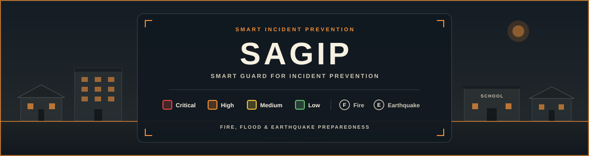

  

    

  <h1>SAGIP — Disaster Hazard Detection System</h1>

  

    <strong>Real-time camera object detection and fire, flood, and earthquake risk assessment.</strong>
  

  

    <a href="#1-running-the-java-desktop-application">Desktop App (Java Swing)</a> &bull;
    <a href="#2-running-the-web-application">Web App (React)</a> &bull;
    <a href="#3-local-storage-and-json-archive">JSON &amp; Capture Storage</a> &bull;
    <a href="#4-object-oriented-programming-oop-architecture">OOP Architecture</a>
  

  
  
  
  

